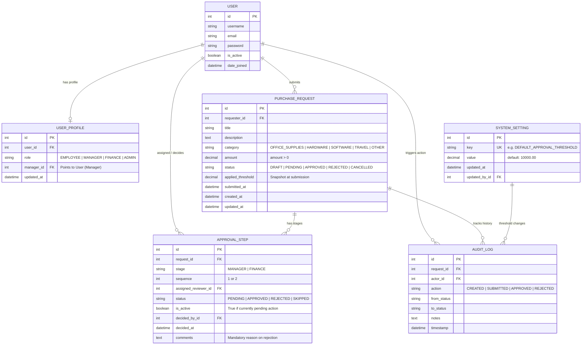

# ApproveFlow — Day 2: Database Architecture & Schema Design

## 1. Objective & Requirements Overview

The goal of this document is to define and justify the database architecture for **ApproveFlow** in accordance with **PRD Requirement 06 (Database Architecture)**.

ApproveFlow requires a relational schema that models:
1. **User Identity & Organizational Hierarchy**: Employees, Managers, Finance, and Admins, plus manager-subordinate relationships.
2. **Purchase / Expense Requests**: Requests with categories, descriptions, positive monetary amounts, and draft/submitted lifecycles.
3. **Multi-Stage Approval Workflow**: Sequential approval stages where requests $\le$ threshold require only Manager review, and requests $>$ threshold require Manager followed by Finance review.
4. **Policy Stability**: Preserving the threshold value applied at the exact time of request submission, even if an Admin modifies the system threshold later.
5. **Audit History & Immutability**: Full traceability of all workflow state changes, timestamps, reviewers, and mandatory rejection reasons.

---

## 2. Database Choice & Technical Justification

### Selected Database: **PostgreSQL**

#### Technical Justification:
1. **ACID Compliance & Robust Transactions**: Workflow approvals cannot afford partial writes or race conditions (e.g. conflicting concurrent decisions). PostgreSQL provides battle-tested serializable and read-committed transaction isolation levels.
2. **Row-Level Locking (`FOR UPDATE`)**: Allows the backend to safely acquire an exclusive lock on an active approval request during status transitions (`select_for_update()`), preventing duplicate decisions from concurrent reviewer requests.
3. **Native Constraint Support**: Strong support for check constraints (e.g., verifying `amount > 0` at the database level) and compound unique constraints (ensuring only one active approval step per sequence).
4. **Indexing & Performance**: Native B-tree indexes on foreign keys (`requester_id`, `assigned_reviewer_id`, `status`) guarantee fast queries for reviewer pending queues and user request histories.
5. **JSONB Audit Logging**: Flexible storage for historical snapshots and metadata without sacrificing query performance.

---

## 3. Entity-Relationship (ER) Diagram



---

## 4. Table Schema & Field Specifications

### 4.1. `user_profiles` (Extends Django `auth.User`)
Maps business roles and reports-to hierarchy to Django's standard authentication user.

| Field Name | Type | Constraints / Attributes | Description |
| :--- | :--- | :--- | :--- |
| `id` | BigAutoField | Primary Key | Profile record ID |
| `user_id` | OneToOneField | `User`, `on_delete=CASCADE` | References auth user |
| `role` | CharField(20) | Choices: `EMPLOYEE`, `MANAGER`, `FINANCE`, `ADMIN` | Business role |
| `manager_id` | ForeignKey | `User`, Nullable, `on_delete=SET_NULL`, related_name='subordinates' | Reports-to manager |
| `created_at` | DateTimeField | `auto_now_add=True` | Record creation time |
| `updated_at` | DateTimeField | `auto_now=True` | Record update time |

*Why separate `UserProfile` vs Custom User?*
- Preserves the existing `auth.User` model already migrated in `0001_initial.py` without requiring destructive table rewrites or risky authentication migrations.
- Keeps authentication concerns (passwords, usernames, JWT tokens) clean and separated from domain permissions.

---

### 4.2. `system_settings`
Stores administrative configurable policies such as the global approval threshold.

| Field Name | Type | Constraints / Attributes | Description |
| :--- | :--- | :--- | :--- |
| `id` | BigAutoField | Primary Key | Setting record ID |
| `key` | CharField(50) | Unique | Parameter name (`approval_threshold`) |
| `value` | DecimalField(12, 2) | Default `10000.00` | Current active threshold in INR |
| `updated_at` | DateTimeField | `auto_now=True` | Last modification time |
| `updated_by_id` | ForeignKey | `User`, Nullable, `on_delete=SET_NULL` | Admin who changed setting |

---

### 4.3. `purchase_requests`
Stores purchase and expense requests with full lifecycle states.

| Field Name | Type | Constraints / Attributes | Description |
| :--- | :--- | :--- | :--- |
| `id` | BigAutoField | Primary Key | Request ID |
| `requester_id` | ForeignKey | `User`, `on_delete=PROTECT` | Submitting employee |
| `title` | CharField(200) | Required | Brief summary of purchase |
| `description` | TextField | Optional (`blank=True`) | Detailed item justification |
| `category` | CharField(50) | Choices: `HARDWARE`, `SOFTWARE`, `TRAVEL`, `OFFICE_SUPPLIES`, `OTHER` | Expense category |
| `amount` | DecimalField(12, 2) | `CheckConstraint(amount > 0)` | Requested monetary amount |
| `status` | CharField(20) | Choices: `DRAFT`, `PENDING`, `APPROVED`, `REJECTED`, `CANCELLED` | High-level status |
| `applied_threshold` | DecimalField(12, 2) | Nullable | **Policy snapshot:** threshold at submission |
| `submitted_at` | DateTimeField | Nullable | Submission timestamp (locks editing) |
| `created_at` | DateTimeField | `auto_now_add=True` | Timestamp created |
| `updated_at` | DateTimeField | `auto_now=True` | Timestamp updated |

---

### 4.4. `approval_steps`
Represents the discrete, ordered approval checkpoints generated upon request submission.

| Field Name | Type | Constraints / Attributes | Description |
| :--- | :--- | :--- | :--- |
| `id` | BigAutoField | Primary Key | Step ID |
| `request_id` | ForeignKey | `PurchaseRequest`, `on_delete=CASCADE`, related_name='steps' | Parent request |
| `stage` | CharField(20) | Choices: `MANAGER`, `FINANCE` | Review level |
| `sequence` | PositiveIntegerField | `1` (Manager), `2` (Finance) | Execution order |
| `assigned_reviewer_id`| ForeignKey | `User`, Nullable, `on_delete=SET_NULL` | Specific reviewer (e.g. manager) |
| `status` | CharField(20) | Choices: `PENDING`, `APPROVED`, `REJECTED`, `SKIPPED` | Status of this step |
| `is_active` | BooleanField | Default: `False` | Only `True` if currently pending review |
| `decided_by_id` | ForeignKey | `User`, Nullable, `on_delete=SET_NULL` | Actual decision maker |
| `decided_at` | DateTimeField | Nullable | Decision timestamp |
| `comments` | TextField | Optional (Mandatory on rejection) | Reviewer notes or rejection reason |

**Compound Constraints:**
- `UniqueConstraint(fields=['request', 'sequence'], name='unique_step_per_request_sequence')` ensures no duplicate sequence numbers exist for the same request.

---

### 4.5. `audit_logs`
An append-only historical log ensuring immutable auditability for regulatory and compliance review.

| Field Name | Type | Constraints / Attributes | Description |
| :--- | :--- | :--- | :--- |
| `id` | BigAutoField | Primary Key | Audit entry ID |
| `request_id` | ForeignKey | `PurchaseRequest`, Nullable, `on_delete=SET_NULL` | Related request |
| `actor_id` | ForeignKey | `User`, Nullable, `on_delete=SET_NULL` | User who took the action |
| `action` | CharField(50) | e.g. `DRAFT_CREATED`, `SUBMITTED`, `STEP_APPROVED`, `REJECTED` | Action name |
| `from_status` | CharField(30) | Nullable | State before transition |
| `to_status` | CharField(30) | Nullable | State after transition |
| `details` | TextField | Blankable | Context, notes, or rejection reasons |
| `timestamp` | DateTimeField | `auto_now_add=True` | Immutable event timestamp |

---

## 5. Business Rule Implementations at the Data Layer

1. **Only Drafts Can Be Edited**:
   Enforced in serializer validation and service logic:
   ```python
   if request.status != RequestStatus.DRAFT:
       raise ValidationError("Only draft requests can be edited.")
   ```
2. **Threshold Policy Stability**:
   When transitioning from `DRAFT` $\to$ `SUBMITTED`, the active system threshold is captured in `purchase_request.applied_threshold`. All subsequent routing checks (`amount > request.applied_threshold`) reference this field rather than the global setting.
3. **Approval Progression Logic**:
   - $\text{Amount} \le \text{Threshold}$: Exactly 1 step created (`sequence=1, stage=MANAGER, is_active=True`).
   - $\text{Amount} > \text{Threshold}$: Exactly 2 steps created:
     - Step 1: `sequence=1, stage=MANAGER, is_active=True`
     - Step 2: `sequence=2, stage=FINANCE, is_active=False` (activated only when Step 1 is approved).
4. **Rejection Ends Workflow**:
   If any active step is `REJECTED`, the request status transitions immediately to `REJECTED`, any future pending steps are marked `SKIPPED`, and no further action is permitted.
5. **No Self-Approval**:
   A database-level or serializer-level check ensures `assigned_reviewer_id != requester_id`.
